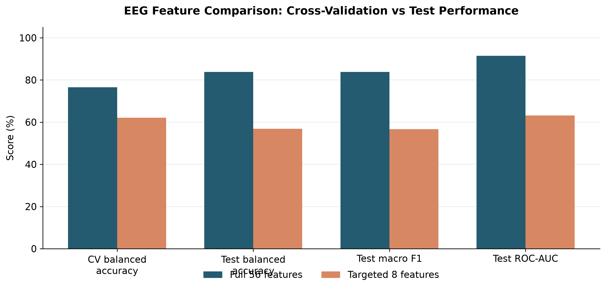

# Does a Workload Decoder Survive a New Brain?

## Cross-Subject Generalization of EEG-Based Cognitive Workload Classification

**ES 678 — M.Tech Research Project**  
**Indian Institute of Technology Gandhinagar**

**Author:** Lavisha Ulkesh Desai
**Roll Number:** 26250021  
**Year:** 2026

---

## 1. Overview

EEG-based cognitive workload classification aims to identify changes in a person's mental workload using electrical brain activity.

However, a model that performs well on people whose data it has already seen may not generalize to entirely new individuals.

This project investigates that problem using the publicly available **STEW (Simultaneous Task EEG Workload) dataset**. It examines how well EEG-based classifiers distinguish between resting and multitasking recordings when evaluated on participants excluded entirely from model training.

The central research question is:

> Does an EEG-based workload classifier trained on some individuals generalize to previously unseen individuals?

The project compares a model using all extracted EEG band-power features with a model using a smaller, predefined set of eight frontal-theta and posterior-alpha features.

---

## 2. Dataset

The experiments use the publicly available STEW dataset.

**Dataset characteristics:**

| Property | Description |
|---|---|
| Participants | 48 |
| EEG channels | 14 |
| Sampling frequency | 128 Hz |
| Resting recording | 150 seconds per participant |
| Multitasking recording | 150 seconds per participant |
| Conditions | Resting and multitasking |
| Window duration | 4 seconds |
| Samples per window | 512 |
| Windows per recording | 37 |
| Total windows | 3,552 |
| Windows per condition | 1,776 |

Each participant contributes recordings from two conditions:

- **Resting:** Recording collected during the resting condition.
- **Multitasking:** Recording collected during the multitasking condition.

The final two seconds of each 150-second recording are not used because only complete, non-overlapping four-second windows are retained.

The two conditions are used as proxies for relatively lower and higher cognitive workload. They are not direct measurements of subjective workload.

**Original dataset:**  
Lim, W. L., Sourina, O., and Wang, L. P. (2018). STEW: Simultaneous Task EEG Workload Dataset.  
[IEEE Xplore — Dataset paper](https://doi.org/10.1109/TNSRE.2018.2872924)

The raw dataset is not redistributed in this repository. Users must obtain it from the original source and place the recordings in the expected local data directory.

---

## 3. Methodology

### 3.1 Preprocessing and Windowing

Each recording is divided into non-overlapping windows of four seconds.

At a sampling frequency of 128 Hz, each window contains:

\[
4 \times 128 = 512 \text{ samples}
\]

The mean of each EEG channel is removed within each window before feature extraction.

This produces 37 complete windows from each 150-second recording.

Across 48 participants and two conditions, the resulting dataset contains:

\[
48 \times 2 \times 37 = 3552 \text{ windows}
\]

### 3.2 Feature Extraction

Welch's method is used to estimate the power spectral density (PSD) of each EEG window.

Power is integrated over four frequency bands:

| Frequency band | Range |
|---|---|
| Delta | 1–4 Hz |
| Theta | 4–8 Hz |
| Alpha | 8–13 Hz |
| Beta | 13–30 Hz |

The extracted band-power values are log-transformed using a base-10 logarithm.

With 14 EEG channels and four frequency bands, each window produces:

\[
14 \times 4 = 56 \text{ features}
\]

No explicit artifact-rejection procedure is applied in this analysis.

### 3.3 Models

Three approaches are evaluated:

**1. Majority-class baseline**

A simple baseline that predicts the most frequent class in the training data.

**2. Full-feature logistic regression**

A logistic regression classifier using all 56 extracted band-power features.

**3. Targeted-feature logistic regression**

A logistic regression classifier using eight predefined features:

- Frontal theta: AF3, AF4, F3, F4
- Posterior alpha: P7, P8, O1, O2

The eight-feature model is included as a comparison of a smaller, specified feature set against the full representation. It should not be interpreted as a validated biomarker or an independently established optimal feature set.

Both logistic regression models use:

- StandardScaler for feature standardization
- LogisticRegression with balanced class weights
- Regularization parameter \(C\) selected from:

\[
C \in \{0.01, 0.1, 1, 10\}
\]

Scaling is fitted using training data within each cross-validation fold to avoid data leakage.

---

## 4. Experimental Design

The main evaluation uses a participant-independent train-test split.

| Split | Participants | EEG windows |
|---|---:|---:|
| Training | 38 | 2,812 |
| Held-out testing | 10 | 740 |
| Total | 48 | 3,552 |

All windows from a participant belong exclusively to either the training set or the test set.

This prevents windows from the same participant appearing in both sets.

### Hyperparameter Selection

The regularization parameter is selected using five-fold StratifiedGroupKFold cross-validation on the training participants.

The grouping is performed by participant, ensuring that windows from a participant remain within the same fold.

The held-out test participants are not used for model selection.

**Random seed:** 42

The main evaluation therefore measures performance on participants whose recordings were not used during training or hyperparameter selection.

---

## 5. Results

### 5.1 Held-Out Participant Performance

The following results are obtained on the ten held-out participants.

| Model | Balanced Accuracy | Macro F1 | ROC-AUC |
|---|---:|---:|---:|
| Majority baseline | 50.00% | 0.333 | — |
| Full 56 features | 83.78% | 0.838 | 0.915 |
| Targeted 8 features | 56.89% | 0.567 | 0.632 |

The full-feature model performs substantially better than the majority baseline and the targeted-feature model on the held-out participants.

### 5.2 Participant-Level Analysis

The full-feature model achieves a mean participant-level balanced accuracy of **83.78%**, with a standard deviation of **13.12 percentage points**.

The targeted-feature model achieves a mean participant-level balanced accuracy of **56.89%**, with a standard deviation of **20.77 percentage points**.

The performance difference between the two models is:

**26.89 percentage points**

A participant-level bootstrap analysis with 10,000 resamples gives:

| Quantity | Estimate | 95% Bootstrap Confidence Interval |
|---|---:|---:|
| Full-feature model | 83.78% | 75.54%–90.95% |
| Targeted-feature model | 56.89% | 45.00%–69.46% |
| Paired difference | 26.89 percentage points | 13.65–41.49 percentage points |

The results indicate that the full feature representation performs better than the predefined eight-feature representation in this held-out participant evaluation.

### 5.3 Error Analysis

For the full-feature model, the held-out test confusion matrix contains:

| Actual condition | Predicted resting | Predicted multitasking |
|---|---:|---:|
| Resting | 303 | 67 |
| Multitasking | 53 | 317 |

The model correctly classifies 620 out of 740 test windows.

The remaining 120 windows are misclassified.

The participant-level results also show variation in generalization performance. The full-feature model's balanced accuracy ranges from **62.16% to 98.65%** across the ten held-out participants.

This variation highlights that overall performance does not imply equally reliable predictions for every individual.

---

## 6. Visual Results

The repository includes visualizations of the evaluation results.

### Confusion Matrix


### Participant-Level Accuracy


### Model Comparison



These figures summarize classification errors, differences in participant-level performance, and the comparison between the evaluated models.

---

## 7. Reproducing the Analysis

### 7.1 Requirements

The analysis uses Python and common scientific-computing libraries.

Install the dependencies using:

```bash
pip install -r requirements.txt
```

### 7.2 Dataset Setup

Obtain the STEW dataset from its original source.

Place the downloaded recordings in the expected local data directory. If the scripts support a custom data directory, it can be supplied using the `--data-dir` argument.

The raw recordings are not included in this repository.

### 7.3 Running the Analysis

The project scripts are organized into separate stages.

Run the scripts from the repository root, following the order below:

```bash
python scripts/inspect_dataset.py
```

Inspect the dataset structure and recording files.

```bash
python scripts/extract_features.py
```

Preprocess the recordings and extract EEG band-power features.

```bash
python scripts/evaluate_models.py
```

Train and evaluate the classification models.

```bash
python scripts/participant_analysis.py
```

Perform participant-level analysis and bootstrap confidence-interval estimation.

```bash
python scripts/make_figures.py
```

Generate the result visualizations.

The exact input and output paths are defined by the individual scripts and their command-line arguments.

### 7.4 Reproducibility Details

| Setting | Value |
|---|---|
| Random seed | 42 |
| Training participants | 38 |
| Held-out participants | 10 |
| Cross-validation | 5-fold StratifiedGroupKFold |
| Grouping variable | Participant |
| Window duration | 4 seconds |
| Sampling frequency | 128 Hz |
| Features per window | 56 |
| Frequency bands | Delta, theta, alpha, beta |
| Classifier | Logistic regression |
| Regularization grid | 0.01, 0.1, 1, 10 |
| Bootstrap resamples | 10,000 |

For exact reproduction, use the same dataset recordings and the same participant split, preprocessing, feature extraction, model configuration, and random seed.

---

## 8. Interactive Project Website

The repository also contains a lightweight website presenting the project, its motivation, methodology, and results.

To run it locally:

```bash
python -m http.server 8000 --directory website
```

Then open:

```text
http://localhost:8000
```

Any illustrative or synthetic EEG traces shown on the website are for visualization purposes and should not be interpreted as actual participant recordings.

---

## 9. Repository Structure

```text
eeg-cross-subject-generalization/
│
├── figures/
│   ├── figure1_confusion_matrix.png
│   ├── figure2_participant_accuracy.png
│   └── figure3_model_comparison.png
│
├── results/
│   ├── model_results.csv
│   ├── participant_results.csv
│   └── ...
│
├── scripts/
│   ├── inspect_dataset.py
│   ├── extract_features.py
│   ├── evaluate_models.py
│   ├── participant_analysis.py
│   └── make_figures.py
│
├── website/
│
├── .gitignore
├── requirements.txt
└── README.md
```

The exact files in the `results/` directory may depend on the outputs generated by the analysis scripts.

---

## 10. Limitations

Several limitations should be considered when interpreting the results.

1. **Proxy workload labels:** Resting and multitasking conditions are used as proxies for lower and higher cognitive workload. They are not direct measurements of subjective workload.

2. **Fixed recording order:** Resting recordings precede multitasking recordings. Consequently, condition differences may be confounded with recording order, fatigue, or time-related effects.

3. **Artifact handling:** No explicit artifact-rejection procedure is applied. EEG noise and artifacts may influence the extracted features.

4. **Limited held-out participants:** The main test set contains ten participants. A larger and more diverse test population would provide stronger evidence of generalization.

5. **Feature-set interpretation:** The eight selected features are a predefined comparison set, not a validated biomarker or proof that these frequency bands are unimportant.

6. **Dataset scope:** The conclusions are limited to the recordings, participants, and experimental conditions represented in the STEW dataset.

The results should therefore be interpreted as an evaluation of participant-independent classification within this dataset, rather than evidence of a clinically validated or universally generalizable workload-monitoring system.

---

## 11. References

1. Lim, W. L., Sourina, O., and Wang, L. P. (2018). STEW: Simultaneous Task EEG Workload Dataset. *IEEE Transactions on Neural Systems and Rehabilitation Engineering*, 26(11), 2106–2114.  
   https://doi.org/10.1109/TNSRE.2018.2872924

2. Welch, P. D. (1967). The use of fast Fourier transform for the estimation of power spectra: A method based on time averaging over short, modified periodograms. *IEEE Transactions on Audio and Electroacoustics*, 15(2), 70–73.  
   https://doi.org/10.1109/TAU.1967.1161901

---

## 12. AI-Use Disclosure

ChatGPT and Claude were used as AI-assisted tools during this project for coding assistance, debugging, documentation, website implementation, and editing of the research paper and project materials.

The author reviewed the generated suggestions, checked the experimental code and outputs, and takes responsibility for the final implementation, analysis, interpretation, and claims presented in this repository and the accompanying paper.

---

**Project developed as an individual ES 678 course research project at the Indian Institute of Technology Gandhinagar.**
