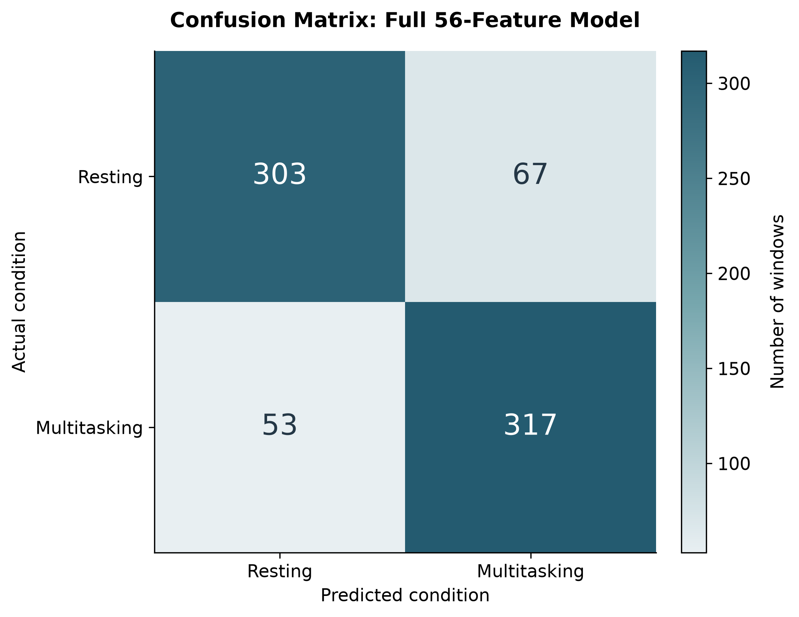
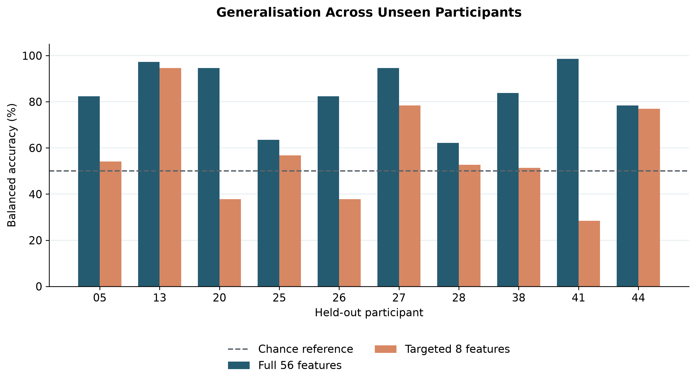

# Does a Workload Decoder Survive a New Brain?
## Cross-Subject Generalization of EEG-Based Cognitive Workload Classification

**ES 678 — Course Research Project**  
**Indian Institute of Technology Gandhinagar**  
**Author:** Lavisha Ulkesh Desai  
**Roll Number:** 26250021  
**Year:** 2026

---

## Overview

EEG-based cognitive workload classification is often evaluated using data from participants who may also appear in the training set. However, a practically useful workload classifier should ideally generalize to individuals it has never encountered.

This project investigates cross-subject generalization using the **Simultaneous Task EEG Workload (STEW)** dataset. It evaluates whether a classifier trained on some participants can distinguish resting and multitasking recording conditions in previously unseen participants.

The central research question is:

> **How well does EEG-based workload classification generalize to previously unseen participants?**

Resting and multitasking are treated as recording conditions that serve as proxies for lower and higher cognitive workload. They are not direct measurements of subjective workload in this experiment.

## Dataset

The project uses the public STEW EEG dataset.

| Property | Description |
|---|---|
| Participants | 48 |
| EEG channels | 14 |
| Sampling frequency | 128 Hz |
| Recording duration | 150 seconds per condition |
| Conditions | Resting (`lo`) and multitasking (`hi`) |
| Window duration | 4 seconds |
| Total windows | 3,552 |

Each recording was divided into non-overlapping four-second windows, producing 37 windows per recording. The final two seconds of each recording were not used.

**Dataset source:** [STEW — Simultaneous Task EEG Workload Dataset](https://ieee-dataport.org/open-access/stew-simultaneous-task-eeg-workload-dataset)

## Methodology

### Feature extraction

Each four-second EEG window was processed as follows:

1. The mean was removed independently from each channel.
2. Welch power spectral density was estimated.
3. Spectral power was integrated over four frequency bands:
   - Delta: 1–4 Hz
   - Theta: 4–8 Hz
   - Alpha: 8–13 Hz
   - Beta: 13–30 Hz
4. Band power was log-transformed.

This produced 56 features per window (14 channels × 4 frequency bands).

### Experimental design

The train-test split was performed at the participant level to prevent windows from the same participant appearing in both sets.

| Partition | Participants | Windows |
|---|---:|---:|
| Training | 38 | 2,812 |
| Held-out test | 10 | 740 |
| Total | 48 | 3,552 |

Hyperparameter selection used five-fold `StratifiedGroupKFold` cross-validation, grouped by participant, within the training set.

### Models

Three approaches were evaluated:

- **Majority baseline:** predicts the most frequent training class.
- **Full-feature model:** logistic regression using all 56 features.
- **Targeted-feature model:** logistic regression using eight frontal-theta and posterior-alpha features.

Both logistic regression models used feature standardization and class weighting. The regularization parameter \(C\) was selected from `{0.01, 0.1, 1, 10}` using grouped cross-validation.

## Results

Performance on the ten held-out participants:

| Model | Features | CV Balanced Accuracy | Test Balanced Accuracy | Macro F1 | ROC-AUC |
|---|---:|---:|---:|---:|---:|
| Majority baseline | 0 | — | 50.00% | 0.333 | — |
| Full feature model | 56 | 76.59% | **83.78%** | 0.838 | 0.915 |
| Targeted feature model | 8 | 62.06% | 56.89% | 0.567 | 0.632 |

The full 56-feature model performed better than the targeted eight-feature model on this held-out split.

### Participant-level analysis

The full model achieved a mean participant-level balanced accuracy of 83.78% (standard deviation 0.131), compared with 56.89% (standard deviation 0.208) for the targeted model.

The paired mean difference was 26.89 percentage points. Its participant-level bootstrap 95% confidence interval was 13.65–41.49 percentage points.

These estimates are based on only ten held-out participants and should be interpreted cautiously.

## Visual Results

### Confusion Matrix



### Participant-Level Performance



### Model Comparison


## Reproducing the Analysis

### 1. Install dependencies

```bash
pip install -r requirements.txt
```

### 2. Download the STEW dataset

Place the 96 EEG recording files inside `data/STEW/`, or provide the dataset directory using `--data-dir`.

### 3. Run the pipeline

```bash
python scripts/inspect_dataset.py --data-dir "data/STEW"
python scripts/extract_features.py --data-dir "data/STEW"
python scripts/evaluate_models.py
python scripts/participant_analysis.py
python scripts/make_figures.py
```

The feature matrix is generated locally and is not included in the repository.

## Interactive Research Website

An interactive website presents the research question, experimental design, results, figures, and a schematic EEG signal illustration.

To run it locally from the repository root:

```powershell
python -m http.server 8000 --directory website
```

Then open [http://localhost:8000](http://localhost:8000).

The animated EEG traces are synthetic illustrations, not actual participant recordings or measured differences between conditions.

## Repository Structure

```text
eeg-cross-subject-generalization/
│
├── figures/
│   ├── figure1_confusion_matrix.png
│   ├── figure2_participant_accuracy.png
│   └── figure3_model_comparison.png
│
├── results/
│   ├── model_results.csv
│   ├── participant_results.csv
│   └── participant_summary.csv
│
├── scripts/
│   ├── inspect_dataset.py
│   ├── extract_features.py
│   ├── evaluate_models.py
│   ├── participant_analysis.py
│   └── make_figures.py
│
├── website/
│   ├── index.html
│   ├── css/
│   ├── js/
│   ├── data/
│   └── assets/
│
├── .gitignore
├── requirements.txt
└── README.md
```

The raw EEG recordings and generated feature matrix are not included in the repository.

## Limitations

- **Proxy labels:** Resting and multitasking are recording conditions used as proxies for workload, not direct subjective workload measurements in this analysis.
- **Small held-out group:** Only ten participants were used for final testing, resulting in uncertain generalization estimates.
- **Recording order:** Resting recordings preceded multitasking recordings. Differences may therefore also reflect order, fatigue, or temporal effects.
- **Artifacts:** No explicit artifact rejection was applied in the current feature extraction pipeline.
- **Feature subset:** The eight-feature comparison should not be interpreted as a validated biomarker set.
- **External validity:** Results on this dataset and held-out split do not establish performance on other datasets, devices, or populations.

## References

Lim, W. L., Sourina, O., & Wang, L. (2018). **STEW: Simultaneous Task EEG Workload Data Set.** *IEEE Transactions on Neural Systems and Rehabilitation Engineering*, 26(11), 2106–2114.  
[https://doi.org/10.1109/TNSRE.2018.2872924](https://doi.org/10.1109/TNSRE.2018.2872924)

[STEW dataset — IEEE DataPort](https://ieee-dataport.org/open-access/stew-simultaneous-task-eeg-workload-dataset)

---

*This project was developed as an individual course research project for ES 678 at IIT Gandhinagar. The accompanying course paper will provide the detailed methodology, evaluation, analysis, and AI-use disclosure.*
